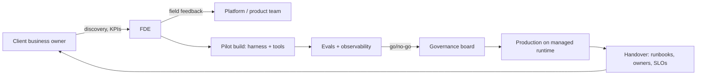

# 01 · AI Architect & FDE: Skills and Roadmap

> Status: DRAFT study material · Source: course syllabus (Week 1 Day 1, Week 3 Day 5)

## 1. Senior concept
- **FDE** = customer-embedded engineer who owns *time-to-value* for a platform at one client. Origin: Palantir (~2007). OpenAI/Anthropic now run FDE / Applied AI orgs.
- Narrow meaning: engineer on-site shipping integrations. Broad meaning: **customer-facing AI solutions architect** who goes from discovery → production → handover.
- Three disciplines (one per course week): **AI Engineering** (models, harness, coding agents) · **AI Architecture** (evals, RAG, durable state, swarms) · **Forward Deployed Engineering** (discovery, governance, security, context layer, production).
- Two kinds of experience: **technical delivery** + **customer partnership**. Job-ad review (316 ads / 184 employers): 89% need ≥4 of 5 skill areas.

## 2. Internals: what the role actually optimises
| Lever | FDE owns | Metric |
|---|---|---|
| Problem framing | Use-case selection, success criteria | Business KPI (cost/claim, cycle time) |
| Delivery | Pilot → prod, integration | Lead time, defect rate |
| Trust | Evals, governance, security | Precision/recall, audit findings |
| Adoption | Handover, enablement | Active users, override rate |
| Feedback | Field → product team | Feature requests closed |

Failure mode: FDE becomes a **bespoke consulting shop** (every client fork). Fix: push generic needs back into the platform; keep client-specific code in config/prompts/tools.

## 3. Enterprise use case
Travel insurer "UnderCover" (course project): claims agent that **approves / declines / refers**; human approval for payouts > $1,000. Scale assumption for interview: 40k claims/day, p95 decision < 30 s, EU + US regions, GDPR + SOC 2.

## 4. Architecture


## 5. Code: portfolio-proof skeleton
```text
your-fde-portfolio/
  01-claims-agent/        # measurable: precision/recall vs human handlers
  02-context-mcp-server/  # governed data access, Cedar/OPA policy
  docs/CASE_STUDY.md      # problem, metric baseline, result, cost/claim
```

## 6. Trade-offs
- **Generalist FDE vs specialist architect**: FDE trades depth for breadth + customer time. Principal roles need both: one deep spike (evals or security) + full-lifecycle breadth.
- **Build per client vs platform feature**: build only when ≥2 clients need it → productise.

## 7. Blind spots
- No measurable baseline before pilot → can't prove ROI.
- Shadow ownership: who is on-call after handover?
- Data access approvals take longer than the build. Start them on day 1.

## 8. Architect answer (template)
"An FDE converts a platform into a measured business outcome at one customer. I start by agreeing a KPI and a baseline, build the thinnest agent that can be evaluated against human decisions, gate production on evals + governance, and hand over with SLOs, runbooks and an owner. Anything two customers need goes back into the product."

## 9. Interview questions
- Senior: How do you pick the first AI use case? · How do you define pilot success? · What do you hand over?
- Staff/Principal: How do you stop FDE work turning into per-client forks? · How do you size an FDE team per account? · How do you report value to a CFO?
- Architect: Design the operating model for 20 FDEs across 50 clients. · Where is the line between FDE and professional services? · How does field feedback reach the roadmap?

## 10. Pressure follow-ups
1. *Client wants a feature that breaks platform design.* → Offer a config/tool extension; escalate with data; never fork core.
2. *Pilot is 90% accurate, handlers 94%.* → Compare cost-weighted errors, not accuracy; ship as copilot/triage first.
3. *No data access after 4 weeks.* → Synthetic/anonymised dataset, parallel approvals, executive sponsor escalation.
4. *How do you prove ROI?* → Baseline cost/claim × volume × automation rate − run cost − error cost.
5. *Why you over a consultancy?* → Ownership through production + product feedback loop.

---
### 🇮🇳 याद रखें (Hindi recall)
- **FDE** = ग्राहक के साथ बैठकर AI को production तक पहुँचाने वाला इंजीनियर।
- तीन skills: AI Engineering, AI Architecture, Forward Deployed Engineering।
- पहला कदम हमेशा: **KPI + baseline** तय करो, फिर build करो।
- जो ज़रूरत 2+ ग्राहकों की है, उसे product में डालो, client fork मत बनाओ।
