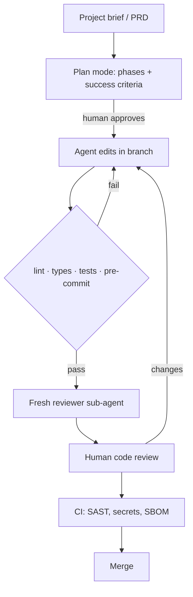

# 02 · Claude Code & the Agentic Development Lifecycle (ADLC)

> Status: DRAFT · Source: Week 1 Day 3, Week 3 Day 1

## 1. Senior concept
- **Two meanings of ADLC**: (a) *Agentic* Development Lifecycle = using coding agents to build software; (b) *Agent* Development Lifecycle = the 5 phases to ship an agent: **Discover → Design → Build → Evaluate → Operate/Hand over**.
- Accountability principle: the agent writes code, **you own it**. Guardrails = AGENTS.md/CLAUDE.md, permission modes, hooks, tests, pre-commit, human review, fresh-context reviewer sub-agent.
- Landscape: Claude Code, Codex CLI, OpenCode, Cursor. Vibe coding is fine for spikes, not for regulated production.

## 2. Internals
- Coding agent = LLM + tools (read/edit/bash/MCP) + loop + context management (compaction) + permissions.
- **Permission modes**: default (ask), acceptEdits, plan (read-only planning), auto/bypass (sandbox only).
- **Context engineering for coding agents**: AGENTS.md (conventions, commands, definition of done), plan files with phases + success criteria, small diffs.
- **MCP servers** extend the agent (e.g., Playwright MCP for UI testing, Supabase MCP for DB).
- Quality gates the agent must pass: lint (ruff/eslint), types (mypy/tsc), tests, pre-commit hook. The agent iterates until green.

## 3. Enterprise use case
Bank platform team: 40 engineers using Claude Code. Controls: org-managed settings deny `curl` to internet and `.env` reads; hooks block commits with secrets; CI re-runs all gates; PR needs human + reviewer sub-agent. Outcome target: 30% lead-time reduction with flat defect escape rate.

## 4. Architecture


## 5. Code: AGENTS.md / CLAUDE.md that keeps you accountable
```markdown
# AGENTS.md
## Commands
- Install: `uv sync` · Test: `uv run pytest -q` · Lint: `uv run ruff check .` · Types: `uv run mypy src`
## Definition of done
- All four commands pass. New logic has tests. No secrets, no network calls in tests.
## Rules
- Business rules (payout math, thresholds) live in code, never in prompts.
- Work in phases from docs/PLAN.md; stop after each phase for review.
- Never edit .env, infra/prod/*, or migrations already applied.
```
```yaml
# .pre-commit-config.yaml
repos:
  - repo: https://github.com/astral-sh/ruff-pre-commit
    rev: v0.6.9
    hooks: [{id: ruff}, {id: ruff-format}]
  - repo: https://github.com/gitleaks/gitleaks
    rev: v8.21.2
    hooks: [{id: gitleaks}]
```

## 6. Trade-offs
| Choice | Pro | Con |
|---|---|---|
| Autonomous long runs | Throughput | Large unreviewable diffs |
| Phase-gated plans | Reviewable, traceable | Slower |
| Claude Code vs Codex vs OpenCode | Quality/tooling vs OpenAI stack vs model-agnostic OSS | Lock-in vs maturity |

## 7. Blind spots
- Agent "passes tests" by editing tests. Protect test dirs or review test diffs separately.
- Prompt injection via repo files / issues read by the agent.
- Licence and provenance of generated code; secrets in context.
- Reviewer fatigue: 2k-line PRs get rubber-stamped.

## 8. Architect answer
"I treat the coding agent as a fast junior with no accountability. I give it a written definition of done, phase-gated plans, and hard gates in hooks and CI. Every change is reviewed by a fresh-context agent and a human, and permissions are least-privilege. That gets speed without moving accountability."

## 9. Interview questions
- Senior: What goes in AGENTS.md? · How do you stop an agent gaming tests? · When do you use plan mode?
- Staff: Roll out coding agents to 200 engineers safely. · Measure productivity impact honestly. · Handle generated-code licensing.
- Architect: Design org-level policy for agent permissions. · Integrate coding agents into SDLC controls for SOX. · ADLC phases for a regulated agent.

## 10. Pressure follow-ups
1. *Metric for success?* → DORA lead time + change failure rate, not lines of code.
2. *Agent needs prod DB access.* → No. Read replica / masked snapshot via MCP with read-only role.
3. *Who is accountable for an agent-written bug?* → The merging engineer and reviewer; same as any code.
4. *How to make reviews tractable?* → Phases, ≤400-line diffs, reviewer sub-agent summary first.
5. *Bypass mode ever OK?* → Only in ephemeral sandbox with no credentials.

---
### 🇮🇳 याद रखें
- Coding agent code लिखता है, **ज़िम्मेदारी तुम्हारी** है।
- AGENTS.md में: commands, definition of done, नियम।
- हर बदलाव: lint + types + tests + review (agent + इंसान)।
- ADLC के 5 चरण: Discover, Design, Build, Evaluate, Operate।
