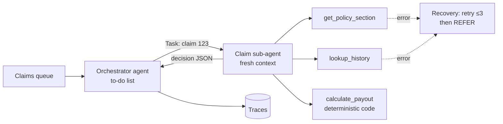

# 03 · Harness Engineering: LangChain, Deep Agents, Claude Agent SDK

> Status: DRAFT · Source: Week 1 Days 1, 2, 5; Week 2 Day 1

## 1. Senior concept
- **Agent** = LLM in a loop choosing tool calls until a goal is met. **Harness** = everything around the model: prompts, tools, loop control, state, recovery.
- Seven parts of a harness: **context · workflow · state · sub-agents · permissions & sandboxing · observability · self-improvement**.
- **Context engineering** > prompt engineering: decide what enters the window, when, and in what shape (just-in-time retrieval, summarisation, sub-agent isolation).
- At its core an agent is "prompts, if statements and while loops" (maze lab: 1 tool, ≤25 steps).

## 2. Internals
- Loop: `messages → LLM → tool_calls? → execute (guarded) → append results → repeat` until final answer or `max_steps`.
- Tool definition = JSON Schema; model emits name + args; harness validates, executes, returns result.
- Recovery: catch tool errors, return them as tool results (model self-corrects); bounded retries; fallback model.
- Sub-agents: fresh context per task → isolation, cheaper models, parallelism, ring-fenced permissions, independent evaluator.
- Build vs buy: **LangChain `create_agent`** (thin, model-agnostic), **Deep Agents** (planning/to-do, file system, sub-agents built in), **Claude Agent SDK** (Claude Code's harness: tools, permissions, hooks, sub-agents, MCP).

## 3. Enterprise use case
Claims desk: orchestrator with to-do list; per-claim helper sub-agent; tools `get_policy_section`, `lookup_claim_history`, `calculate_payout` (pure code). Errors from the claims API return as tool messages; after 3 failures, claim is referred to a human.

## 4. Architecture


## 5. Code
Agent loop from first principles (OpenAI-compatible client, e.g. OpenRouter):
```python
import json, os
from openai import OpenAI

client = OpenAI(base_url="https://openrouter.ai/api/v1", api_key=os.environ["OPENROUTER_API_KEY"])
TOOLS = [{"type": "function", "function": {
    "name": "get_policy_section", "description": "Return policy text for a section id",
    "parameters": {"type": "object", "properties": {"section": {"type": "string"}}, "required": ["section"]}}}]
POLICY = {"4.2": "Baggage delay over 12h: up to $300."}

def run_tool(name: str, args: dict) -> str:
    if name != "get_policy_section":          # guardrail: allowlist
        return "error: unknown tool"
    return POLICY.get(args.get("section", ""), "error: no such section")

def agent(claim: str, model: str = "openrouter/free", max_steps: int = 10) -> str:
    msgs = [{"role": "system", "content": "Decide APPROVE/DECLINE/REFER with reason."},
            {"role": "user", "content": claim}]
    for _ in range(max_steps):                 # bounded loop
        r = client.chat.completions.create(model=model, messages=msgs, tools=TOOLS, timeout=30)
        m = r.choices[0].message
        if not m.tool_calls:
            return m.content
        msgs.append(m)
        for tc in m.tool_calls:
            out = run_tool(tc.function.name, json.loads(tc.function.arguments or "{}"))
            msgs.append({"role": "tool", "tool_call_id": tc.id, "content": out})
    return "REFER: step budget exhausted"
```
LangChain v1 `create_agent` with structured output:
```python
from pydantic import BaseModel
from typing import Literal
from langchain.agents import create_agent
from langchain.tools import tool

class Decision(BaseModel):
    decision: Literal["APPROVE", "DECLINE", "REFER"]
    payout: float
    reason: str

@tool
def calculate_payout(claimed: float, limit: float, excess: float) -> float:
    """Deterministic payout: min(claimed, limit) minus excess, floored at 0."""
    return max(0.0, min(claimed, limit) - excess)

agent = create_agent(model="openai:gpt-4.1-mini", tools=[calculate_payout],
                     system_prompt="You are a claims handler.", response_format=Decision)
result = agent.invoke({"messages": [{"role": "user", "content": "Bag delayed 14h, claimed $420"}]})
print(result["structured_response"])
```
Claude Agent SDK with a sub-agent:
```python
from claude_agent_sdk import query, ClaudeAgentOptions, AgentDefinition

opts = ClaudeAgentOptions(
    system_prompt="Work the claims queue. Delegate each claim to claim-reviewer.",
    allowed_tools=["Read", "Task"],              # least privilege
    agents={"claim-reviewer": AgentDefinition(
        description="Reviews one claim against the manual",
        prompt="Return JSON decision with citation.", tools=["Read"], model="haiku")},
    max_turns=20)
async for msg in query(prompt="Process claims/batch-01.json", options=opts):
    print(msg)
```

## 6. Trade-offs
| Option | Best for | Watch out |
|---|---|---|
| From scratch | Learning, tiny surface | You rebuild recovery, tracing |
| LangChain `create_agent` | Model-agnostic, middleware | Abstraction churn |
| Deep Agents | Long multi-step research/planning | Token cost of planning + FS |
| Claude Agent SDK | Best Claude tooling, hooks, permissions | Claude-centric |

## 7. Blind spots
- Business logic in prompts (payout math) → non-deterministic money. Put it in a tool.
- Unbounded loops → cost blowups. Always `max_steps`, token budget, wall-clock timeout.
- Tool errors swallowed → silent wrong decisions.
- Sub-agents everywhere → latency + cost without measured gain.

## 8. Architect answer
"I design the harness before choosing the framework: what context each step needs, which logic is deterministic code, where state lives, what each component may touch, and how it is traced and evaluated. I add sub-agents only for isolation, independent evaluation, cheaper models, parallelism or permissions, and only when evals show a gain."

## 9. Interview questions
- Senior: Agent vs workflow? · How do tool errors flow back? · What is context engineering?
- Staff: When do sub-agents pay off? · Build vs buy a harness for a bank? · How do you budget tokens per task?
- Architect: Harness reference architecture for 30 teams. · Portability across model vendors. · Self-improving harness governance.

## 10. Pressure follow-ups
1. *Why not one big prompt?* → Context rot, cost, no isolation, untestable.
2. *Agent loops forever.* → Step/token/time caps; loop detection on repeated tool+args.
3. *Framework is deprecated next year.* → Keep tools/prompts/evals framework-neutral; thin adapters.
4. *Model invents a tool.* → Allowlist + schema validation; return error.
5. *Deterministic or agentic?* → If the path is known, code orchestrates; agents only where judgement is needed.

---
### 🇮🇳 याद रखें
- Agent = LLM + tools + loop। Harness = उसके चारों ओर का सब कुछ।
- Harness के 7 हिस्से: context, workflow, state, sub-agents, permissions, observability, self-improvement।
- पैसे का हिसाब **code में**, prompt में नहीं।
- Loop हमेशा सीमित: max steps, token budget, timeout।
