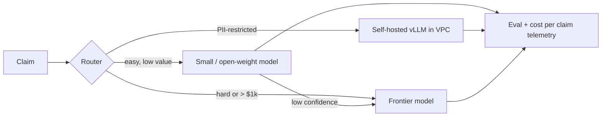

# 04 · Choosing Frontier, Open-Weight and Local LLMs

> Status: DRAFT · Source: Week 1 Days 2, 4, 5. Model names below are as the course names them; verify current versions before quoting.

## 1. Senior concept
- Four axes: **intelligence · speed (latency, tokens/s) · token cost · privacy/control**. Pick on the **Pareto front** for *your* task, measured on *your* eval set.
- Benchmarks: Artificial Analysis (intelligence vs cost vs speed), METR (task-length horizon). Public leaderboards are a shortlist, not a decision.
- **Proprietary** (API only) vs **open-weight** (weights downloadable, licence varies) vs **open-source** (weights + data/code). Open-weight ≠ private: hosted by a third party it is just another API.
- The unit of cost is **cost per business task** (cost/claim), not cost/token. A smarter model that needs fewer steps can be cheaper.

## 2. Internals
- Inference is **memory-bandwidth bound** for decoding: tokens/s ≈ bandwidth ÷ bytes of active weights.
- VRAM need ≈ params × bytes/param (+ KV cache). 70B @ FP16 ≈ 140 GB; @ Q4 ≈ 40 GB.
- **Dense vs MoE**: MoE has total params (memory) ≫ active params (compute per token). Fast like a small model, needs memory like a big one.
- **Quantisation**: FP16 → INT8 → Q4 (GGUF for llama.cpp/Ollama; safetensors for HF/vLLM). Quality loss grows below 4-bit.
- **Distillation**: labs likely make small models from big ones → small frontier models punch above weight.
- Serving: Ollama / LM Studio (desktop), **vLLM** (prod: PagedAttention, continuous batching), Cerebras/Groq (very high tokens/s).
- OpenRouter **provider routing**: pin providers, sort by price/throughput, `data_collection: deny`, fallbacks.
- Chat product tricks: system prompt, chat history, tools, RAG, memory, reasoning tokens. Context window = cost and quality limit.

## 3. Enterprise use case
EU insurer, 40k claims/day, avg 6k input + 500 output tokens:
| Option | $/M in/out (illustrative) | Daily cost | Notes |
|---|---|---|---|
| Frontier large | 3 / 15 | ≈ $1,020 | Best accuracy, US/EU region |
| Frontier small | 0.15 / 0.6 | ≈ $48 | Often 95% of quality |
| Open-weight via router | 0.3 / 1.2 | ≈ $96 | Pin EU provider, no retention |
| Self-host vLLM (2×H100) | fixed ≈ $150/day | ≈ $150 | Full control; ops toil |
Decision: small frontier for triage, large model for REFER cases (cascade), self-host only if data residency forbids API.

## 4. Architecture


## 5. Code: compare models on cost, latency, accuracy
```python
import time, os
from openai import OpenAI
client = OpenAI(base_url="https://openrouter.ai/api/v1", api_key=os.environ["OPENROUTER_API_KEY"])

def run(model: str, claims: list[dict]) -> dict:
    correct, cost, t0 = 0, 0.0, time.time()
    for c in claims:
        r = client.chat.completions.create(
            model=model, messages=[{"role": "user", "content": c["prompt"]}],
            extra_body={"provider": {"data_collection": "deny", "sort": "price"}, "usage": {"include": True}},
            timeout=60)
        correct += r.choices[0].message.content.strip().upper().startswith(c["label"])
        cost += getattr(r.usage, "cost", 0) or 0
    return {"model": model, "accuracy": correct / len(claims),
            "cost_per_claim": cost / len(claims), "secs_per_claim": (time.time() - t0) / len(claims)}
```

## 6. Trade-offs
- **API vs self-host**: self-host wins only at high, steady utilisation or hard residency. Count GPU idle time and on-call.
- **One model vs cascade**: cascade cuts cost 5–20× but adds routing errors; evaluate the router too.
- **Open-weight risk**: licence terms, provenance, supply-chain (pickle → use safetensors), unknown safety tuning.

## 7. Blind spots
- Non-determinism: rerun evals ≥3× and report variance.
- Provider variance: same open model, different quantisation per provider → different accuracy.
- Price changes & deprecations: abstract model ids in config.
- Hidden cost: reasoning tokens, retries, long system prompts.

## 8. Architect answer
"I build a task-specific eval, then plot accuracy against cost per task and latency for a shortlist. I pick the cheapest model on the Pareto front that meets the quality bar, add a cascade to a stronger model for hard cases, and only self-host when residency or steady volume justify the ops cost. Model ids live in config so we can switch."

## 9. Interview questions
- Senior: Dense vs MoE memory needs? · What does Q4 cost you? · Why tokens/s is bandwidth-bound?
- Staff: Build a model-selection process for an enterprise. · Cascade design and its failure modes. · When does self-hosting pay off?
- Architect: Multi-vendor LLM strategy with residency. · Model lifecycle and deprecation policy. · FinOps for AI at 1B tokens/day.

## 10. Pressure follow-ups
1. *Open-weight = private?* → Only if you host it or contract zero retention.
2. *Cheapest model per token isn't cheapest per claim—why?* → More steps, retries, referrals.
3. *Benchmark says model X is best.* → Not on our data; show our eval.
4. *Vendor outage.* → Multi-provider fallback behind a model gateway.
5. *Estimate VRAM for 30B MoE, 3B active, Q4.* → ≈ 30B × 0.5 B ≈ 15–18 GB + KV; speed like a ~3B dense.

---
### 🇮🇳 याद रखें
- चार पैमाने: बुद्धि, गति, कीमत, privacy।
- **Cost per claim** देखो, cost per token नहीं।
- MoE: memory बड़े model जितनी, speed छोटे model जितनी।
- Open-weight का मतलब private नहीं, जब तक खुद host न करो।
