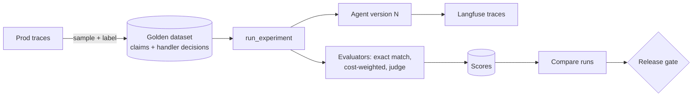

# 05 · Evals & Observability with Langfuse

> Status: DRAFT · Source: Week 2 Day 1, Day 5

## 1. Senior concept
- Three eval kinds: **direct measurement** (curated dataset / real outcomes) · **LLM-as-a-judge** (rubric) · **human review**. Use a **portfolio**: model metrics → task metrics → business outcomes.
- Three architecture traps: designing roles before data; adding agents without measurement; evaluating against proxies, not business outcomes.
- Mistakes are not symmetric. UnderCover tolerates wrongful approval more than wrongful decline → weight errors by **cost**.

## 2. Internals
- **Confusion matrix** (positive = DECLINE): precision = TP/(TP+FP) (of declines we made, how many right); recall = TP/(TP+FN) (of claims that should be declined, how many caught).
- **Cost-weighted score**: Σ cost(actual, predicted). Choose thresholds to minimise expected cost.
- **Cohen's kappa** κ = (pₒ − pₑ)/(1 − pₑ): agreement corrected for chance. Use for agent-vs-handler and judge-vs-human.
- **Noise**: rerun N times, report mean ± sd; a 2-point gain within noise is not a gain.
- **Langfuse**: traces (spans for LLM calls, tools), sessions, scores, **datasets + experiments** (`run_experiment`), prompt management, cost tracking. OTel-based in SDK v3.

## 3. Enterprise use case
Baseline agent 82% agreement; moving payout math into a tool → 88% and zero arithmetic errors. Compared as two Langfuse experiments on the same 50-claim dataset, 3 runs each; κ vs handlers 0.71 → 0.80.

## 4. Architecture


## 5. Code
```python
from collections import Counter
from math import isclose

COST = {("APPROVE", "DECLINE"): 50, ("DECLINE", "APPROVE"): 500, ("REFER", "APPROVE"): 20}

def cohen_kappa(a: list[str], b: list[str]) -> float:
    n = len(a); po = sum(x == y for x, y in zip(a, b)) / n
    ca, cb = Counter(a), Counter(b)
    pe = sum(ca[k] * cb[k] for k in ca) / n**2
    return 1.0 if isclose(pe, 1) else (po - pe) / (1 - pe)

def expected_cost(actual: list[str], pred: list[str]) -> float:
    return sum(COST.get((t, p), 0) for t, p in zip(actual, pred)) / len(actual)
```
Langfuse experiment (SDK v3):
```python
from langfuse import get_client, Evaluation
langfuse = get_client()                       # reads LANGFUSE_* env vars
dataset = langfuse.get_dataset("undercover-claims-v1")

def task(*, item, **_):
    return claims_agent(item.input)           # your agent, traced via callback/decorator

def exact(*, output, expected_output, **_):
    return Evaluation(name="exact", value=float(output["decision"] == expected_output["decision"]))

result = dataset.run_experiment(name="payout-tool-v2", task=task, evaluators=[exact])
print(result.format())
```

## 6. Trade-offs
| Method | Cost | Bias | Use |
|---|---|---|---|
| Exact match on labels | Low | Label quality | Classification decisions |
| LLM judge | Medium | Position/verbosity/self-preference | Free-text reasons, tone |
| Human review | High | Fatigue, disagreement | Calibrating judges, high stakes |
| Online business KPI | Delayed, noisy | Confounders | Final truth (A/B) |
Langfuse vs LangSmith vs Arize/Phoenix vs Datadog LLM: Langfuse = OSS/self-hostable (data residency), others = managed depth or APM integration.

## 7. Blind spots
- Dataset leakage into prompts/few-shots → inflated scores.
- Golden set drifts from production mix; refresh from sampled prod traces.
- PII in traces → mask before export; set retention.
- Judges need their own eval (κ vs humans).

## 8. Architect answer
"Every architecture change is an experiment: same golden dataset, multiple runs, cost-weighted metrics and kappa against human decisions, all traced in Langfuse. Changes ship only if they beat the baseline outside the noise band, and production traces feed back into the dataset."

## 9. Interview questions
- Senior: Precision vs recall for a fraud agent? · Why kappa over accuracy? · What's in a trace?
- Staff: Design a release gate for agents. · How big must the golden set be? · Online vs offline evals.
- Architect: Eval platform for 50 agent teams. · Mapping model metrics to P&L. · Governance evidence from evals for auditors.

## 10. Pressure follow-ups
1. *95% accuracy, ship it?* → Class balance? Approving everything scores 60% here. Show cost-weighted + κ.
2. *Judge agrees with itself.* → Different model family, reference answers, measure vs humans.
3. *Scores vary 5 points run to run.* → Report sd; increase N; lower temperature; fix seeds where possible.
4. *Trace storage cost.* → Sample, drop payload bodies, tiered retention.
5. *Business outcome lags months.* → Leading indicators (override rate, referral rate) + delayed true-up.

---
### 🇮🇳 याद रखें
- Eval के 3 प्रकार: सीधा माप, LLM judge, इंसानी review।
- Precision = जो बोला सही कितना; Recall = जो पकड़ना था, कितना पकड़ा।
- गलतियों की **कीमत अलग** होती है, उसी हिसाब से score करो।
- बदलाव तभी ship करो जब noise से बाहर सुधार हो।
