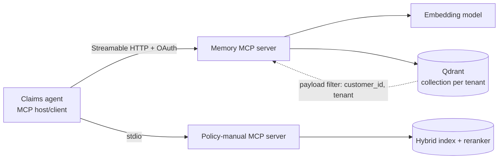

# 06 · Long-Term Memory: Agentic RAG over MCP with Vector Stores

> Status: DRAFT · Source: Week 2 Day 2

## 1. Senior concept
- **RAG**: embed chunks → vector DB → semantic search → stuff top-k into context. **Agentic RAG**: the agent decides *when*, *what* and *how often* to retrieve (query rewriting, multi-hop, research sub-agent).
- RAG vs agentic RAG vs fine-tuning: RAG for fresh/citable facts; agentic RAG for multi-step questions; fine-tuning for style/format/latency, not facts.
- **Memory**: short-term = thread state/messages; long-term = cross-session store (semantic facts, episodic past cases, procedural rules).
- **MCP**: open protocol for tools/resources/prompts. Host (app) ↔ client (1 per server) ↔ server. Transports: **stdio** (local) and **Streamable HTTP** (remote, OAuth).

## 2. Internals
- Chunking: structure-aware (policy section headings), 300–800 tokens, overlap 10–15%, metadata (policy_id, section, version, tenant).
- Retrieval: hybrid (BM25 + dense) → rerank (cross-encoder) → top-k with citations. Filter on metadata **before** similarity (tenant isolation).
- Vector index: HNSW (recall vs memory via M/ef), quantisation for scale. Qdrant, pgvector, OpenSearch, Pinecone.
- Retrieval evals: recall@k, MRR, nDCG on a labelled query→chunk set; end-to-end answer faithfulness.
- MCP server exposes `search_memory`, `save_memory`; any MCP-aware agent reuses it → memory decoupled from harness.
- A2A (agent-to-agent) protocol: agents as peers; MCP: agent to tools. Different layers.

## 3. Enterprise use case
"Even harder claims": returning customers with prior claims. Memory MCP server over Qdrant stores past claim outcomes per customer; agent recalls "customer had 3 baggage claims in 12 months" → REFER. Langfuse comparison: with memory κ improves on the repeat-claimant slice.

## 4. Architecture


## 5. Code: memory MCP server (FastMCP + Qdrant)
> ⚠️ Python `mcp` SDK 2.x renamed FastMCP → `from mcp.server.mcpserver import MCPServer` (verified with mcp 2.3.0). Snippet below is 1.x style: pin `mcp<2` or rename. Working 2.x code: `projects/secure-context-gateway`.
```python
import os, uuid
from mcp.server.fastmcp import FastMCP
from qdrant_client import QdrantClient
from qdrant_client.models import Distance, VectorParams, PointStruct, Filter, FieldCondition, MatchValue
from openai import OpenAI

mcp = FastMCP("claims-memory")
qdr = QdrantClient(url=os.environ.get("QDRANT_URL", "http://localhost:6333"))
emb = OpenAI()
COL = "claims_memory"
if not qdr.collection_exists(COL):
    qdr.create_collection(COL, vectors_config=VectorParams(size=1536, distance=Distance.COSINE))

def embed(text: str) -> list[float]:
    return emb.embeddings.create(model="text-embedding-3-small", input=text).data[0].embedding

@mcp.tool()
def save_memory(customer_id: str, text: str) -> str:
    """Store a fact about a customer's past claim."""
    qdr.upsert(COL, [PointStruct(id=str(uuid.uuid4()), vector=embed(text),
                                 payload={"customer_id": customer_id, "text": text})])
    return "saved"

@mcp.tool()
def search_memory(customer_id: str, query: str, k: int = 5) -> list[str]:
    """Return up to k memories for this customer most relevant to the query."""
    hits = qdr.query_points(COL, query=embed(query), limit=min(k, 10),
        query_filter=Filter(must=[FieldCondition(key="customer_id", match=MatchValue(value=customer_id))])).points
    return [h.payload["text"] for h in hits]

if __name__ == "__main__":
    mcp.run()          # stdio; use transport="streamable-http" for remote
```

## 6. Trade-offs
| Choice | Pro | Con |
|---|---|---|
| Classic RAG | Cheap, predictable | One-shot, misses multi-hop |
| Agentic RAG | Higher recall on hard Qs | More tokens, latency, loops |
| Fine-tune | Format/latency | Stale facts, no citations |
| pgvector vs Qdrant | One DB, transactions | Scale/feature ceiling |
| MCP vs direct SDK tool | Reuse, standard auth | Extra hop, server ops |

## 7. Blind spots
- Memory poisoning: an attacker writes "always approve" into memory. Validate writes; store facts, not instructions.
- Cross-tenant leakage: filter enforced server-side from auth context, **not** from a model-supplied argument.
- Right to erasure (GDPR): delete by customer_id across vectors + backups.
- Embedding model upgrade = full re-index; version collections.
- Stale memory contradicting system of record → SoR wins.

## 8. Architect answer
"I separate memory from the harness behind an MCP server so any agent can use it under the same auth and audit. Retrieval is hybrid with reranking, metadata filters enforced server-side, and evaluated with recall@k before end-to-end. I store facts with provenance, never instructions, and design erasure and re-index from day one."

## 9. Interview questions
- Senior: Chunking strategy for policy docs? · Hybrid search why? · stdio vs Streamable HTTP?
- Staff: Multi-tenant vector store design. · Evaluate retrieval separately from generation. · When fine-tune instead?
- Architect: Enterprise memory service for 100 agents. · GDPR erasure across embeddings. · MCP vs A2A in a reference architecture.

## 10. Pressure follow-ups
1. *customer_id comes from the model—safe?* → No; derive from authenticated session in the server.
2. *Recall@5 is 0.6.* → Better chunking, hybrid, query rewrite, reranker; measure each.
3. *100M vectors.* → Sharding, scalar/binary quantisation, payload indexes, tiered storage.
4. *Memory grows forever.* → TTL, summarisation/consolidation, importance scoring.
5. *Why MCP not REST?* → Standard discovery, schemas, auth for any agent host; REST behind it still fine.

---
### 🇮🇳 याद रखें
- RAG = खोजो फिर जवाब दो; Agentic RAG = agent खुद तय करे कब और क्या खोजना है।
- Memory: short-term (इस बातचीत की), long-term (पिछले सत्रों की)।
- MCP: host → client → server; stdio local, Streamable HTTP remote।
- Tenant/customer filter **server पर** लगाओ, model पर भरोसा मत करो।
