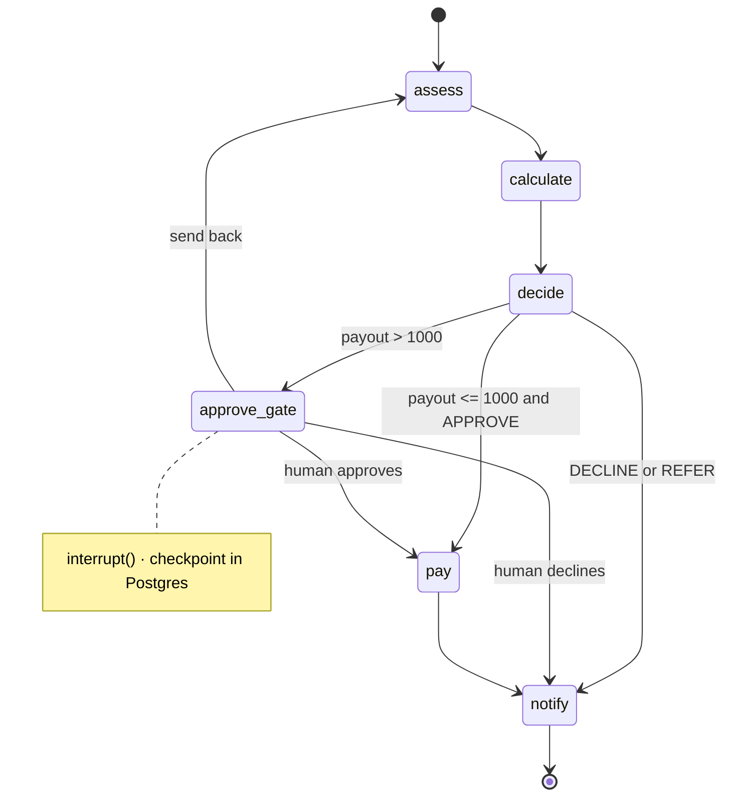

# 07 · Production Workflows in LangGraph: Durable State, Crash Recovery, Human in the Loop

> Status: DRAFT · Source: Week 2 Day 3

## 1. Senior concept
- **Durable execution**: a workflow survives crashes, deploys and multi-day human waits by persisting state after each step and resuming from the last checkpoint.
- LangGraph = graph of **nodes** (functions) over shared **state**, with fixed and conditional **edges**; compiled with a **checkpointer** (Postgres in prod) and keyed by **thread_id**.
- **HITL**: `interrupt()` pauses inside a node; resume with `Command(resume=value)`. Design the human's step: what they see, what they can change, SLA, who is authorised.

## 2. Internals
- **Reducers** merge node outputs into state (e.g., `add_messages`, `operator.add`); without a reducer, last write wins.
- **Super-step**: all nodes scheduled in parallel run in one step (Pregel/BSP); checkpoint written at each super-step boundary.
- On resume, the interrupted node **re-runs from its start** → side effects before `interrupt()` must be idempotent (or moved to a later node).
- Checkpointers: `InMemorySaver` (dev), `PostgresSaver` (Supabase/RDS), managed (LangGraph Platform, AgentCore Memory/sessions).
- Time-travel: replay/fork from any checkpoint for debugging.

## 3. Enterprise use case
Payout > $1,000 → pause for handler sign-off in a dashboard. Kernel crash mid-claim → resume from Supabase Postgres; payment is executed exactly once using an idempotency key = `claim_id`.

## 4. Architecture


## 5. Code
```python
from typing import Annotated, Literal, TypedDict
import operator
from langgraph.graph import StateGraph, START, END
from langgraph.types import interrupt, Command, RetryPolicy
from langgraph.checkpoint.postgres import PostgresSaver

class ClaimState(TypedDict):
    claim_id: str
    claimed: float
    payout: float
    decision: str
    audit: Annotated[list[str], operator.add]     # reducer: append

def calculate(s: ClaimState):
    payout = max(0.0, min(s["claimed"], 300.0) - 25.0)
    return {"payout": payout, "decision": "APPROVE", "audit": [f"payout={payout}"]}

def approve_gate(s: ClaimState) -> Command[Literal["pay", "notify"]]:
    answer = interrupt({"claim_id": s["claim_id"], "payout": s["payout"]})   # pauses here
    ok = answer.get("approved") is True
    return Command(goto="pay" if ok else "notify",
                   update={"decision": "APPROVE" if ok else "DECLINE", "audit": [f"human={answer}"]})

def pay(s: ClaimState):
    payments_api.create(idempotency_key=s["claim_id"], amount=s["payout"])   # exactly-once
    return {"audit": ["paid"]}

def notify(s: ClaimState):
    return {"audit": [f"notified {s['decision']}"]}

def route(s: ClaimState) -> str:
    if s["decision"] != "APPROVE": return "notify"
    return "approve_gate" if s["payout"] > 1000 else "pay"

g = StateGraph(ClaimState)
g.add_node("calculate", calculate)
g.add_node("approve_gate", approve_gate)
g.add_node("pay", pay, retry_policy=RetryPolicy(max_attempts=3))
g.add_node("notify", notify)
g.add_edge(START, "calculate")
g.add_conditional_edges("calculate", route, ["approve_gate", "pay", "notify"])
g.add_edge("pay", "notify"); g.add_edge("notify", END)

with PostgresSaver.from_conn_string(DB_URL) as saver:
    saver.setup()
    app = g.compile(checkpointer=saver)
    cfg = {"configurable": {"thread_id": "claim-123"}}
    app.invoke({"claim_id": "claim-123", "claimed": 5000, "audit": []}, cfg)   # stops at interrupt
    # ...process crashes / days pass...
    app.invoke(Command(resume={"approved": True, "by": "handler-7"}), cfg)      # resumes
```

## 6. Trade-offs
| Option | Pro | Con |
|---|---|---|
| LangGraph + Postgres | Explicit graph, HITL, OSS | You run DB, workers |
| Temporal | Battle-tested durability, any code | Not LLM-native; more infra |
| Step Functions / Durable Functions | Managed, AWS/Azure native | State size limits, vendor lock |
| create_agent only | Simple | No durable multi-day pauses |

## 7. Blind spots
- Non-idempotent side effects before `interrupt()` → double payments on resume.
- Checkpoint bloat: large messages per step; prune/summarise; retention.
- Schema evolution of state across deployed versions; version the graph.
- Approver authz: anyone with the thread_id must not be able to resume.
- PII in checkpoints → encryption at rest, erasure.

## 8. Architect answer
"For regulated, long-running decisions I use an explicit LangGraph state machine with a Postgres checkpointer. Deterministic steps are nodes, judgement steps are agent nodes, and money movement happens once via idempotency keys. Human approval is a first-class interrupt with authorisation, SLA and audit trail, and any crash resumes from the last checkpoint."

## 9. Interview questions
- Senior: What does a reducer do? · What happens on resume after interrupt? · thread_id meaning?
- Staff: Exactly-once payments in an agent workflow. · Migrating state schema with in-flight threads. · LangGraph vs Temporal.
- Architect: HITL design for 10k approvals/day. · Multi-region durable agents. · Audit trail requirements for regulators.

## 10. Pressure follow-ups
1. *Crash during pay.* → Retry with same idempotency key; payment provider dedups.
2. *Human never answers.* → SLA timer → escalate/auto-REFER; reminder job scans pending interrupts.
3. *Deploy new graph with 5k paused threads.* → Backward-compatible state, versioned graphs, drain or migrate.
4. *Why not keep state in the LLM context?* → Not durable, not auditable, costly.
5. *Parallel nodes both write same key.* → Need a reducer or a conflict error.

---
### 🇮🇳 याद रखें
- Durable = crash के बाद भी आखिरी checkpoint से फिर शुरू।
- LangGraph: state + nodes + edges + checkpointer + thread_id।
- `interrupt()` से रुको, `Command(resume=...)` से आगे बढ़ो।
- Resume पर node दोबारा चलता है, इसलिए payment **idempotent** रखो।
