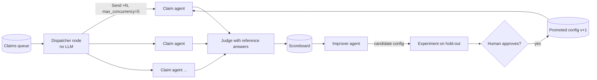

# 08 · Scale & Optimise: Agent Swarms, LLM-as-a-Judge, Recursive Self-Improvement

> Status: DRAFT · Source: Week 2 Days 4–5, Week 1 Day 5

## 1. Senior concept
- **Teams** (few specialised agents collaborating), **swarms** (many identical agents on independent items), **fleets** (many different agents managed as a portfolio).
- Swarm dispatcher needs **no LLM**: fan-out with concurrency limits, rate limits, retries, back-pressure.
- **LLM-as-a-judge** with **reference answers** and a rubric; validate the judge against humans (κ).
- **Recursive self-improvement**: an *improver* agent reads eval failures, proposes prompt/config changes, runs experiments, and a **human approves** promotion.

## 2. Internals
- LangGraph fan-out via `Send` per item; `max_concurrency` in config; `RetryPolicy` on nodes for 429/5xx with backoff + jitter.
- Rate limits: tokens/min and requests/min per provider → token-bucket in dispatcher.
- Judge biases: position, verbosity, self-preference; mitigate with references, binary/ordinal rubrics, a different model family.
- Improver loop: `baseline → failures → hypothesis → candidate config → experiment (N runs) → compare outside noise → human gate → promote`. Guard against overfitting the golden set: hold-out split.

## 3. Enterprise use case
Queue of 25 claims → swarm of 25 claim agents at `max_concurrency=5`; traced in Langfuse; scoreboard compares 5 vs 25 claims for stability. Improver runs 3 rounds on the dashboard; each promoted recipe shows +κ on hold-out.

## 4. Architecture


## 5. Code
```python
import operator
from typing import Annotated, TypedDict
from langgraph.graph import StateGraph, START, END
from langgraph.types import Send, RetryPolicy

class S(TypedDict):
    claims: list[dict]
    results: Annotated[list[dict], operator.add]

def dispatch(s: S):
    return [Send("claim_agent", {"claim": c}) for c in s["claims"]]

def claim_agent(x: dict):
    return {"results": [decide(x["claim"])]}        # LLM agent per claim

g = StateGraph(S)
g.add_node("claim_agent", claim_agent,
           retry_policy=RetryPolicy(max_attempts=4, initial_interval=1.0, backoff_factor=2.0, jitter=True))
g.add_conditional_edges(START, dispatch, ["claim_agent"])
g.add_edge("claim_agent", END)
app = g.compile()
out = app.invoke({"claims": claims, "results": []}, config={"max_concurrency": 5})
```
Judge prompt skeleton:
```text
You grade a claims decision. Reference decision: {ref_decision}. Reference reason: {ref_reason}.
Candidate: {decision} — {reason}
Return JSON {"decision_match": 0|1, "reason_supported_by_policy": 0|1, "critique": "..."}.
Grade only against the policy excerpt provided. Ignore length and style.
```

## 6. Trade-offs
- Swarm vs single sequential agent: throughput vs rate-limit pressure and cost spikes.
- Judge vs exact labels: judge scales to free text but adds cost + its own error.
- Self-improvement vs manual tuning: faster iteration, but risk of overfitting and drift; needs governance.
- 10×/100× scale: move dispatcher to queue workers (SQS/Kafka), per-tenant quotas, batch APIs for cheaper offline runs.

## 7. Blind spots
- Thundering herd on retry without jitter.
- Partial failures: some items fail; need dead-letter + replay, not whole-batch retry.
- Judge and agent same model → correlated errors.
- Improver edits its own eval → Goodhart. Lock eval set and metrics.
- Cost runaway: budget per run, kill switch.

## 8. Architect answer
"Fan-out is plain engineering: a code dispatcher with concurrency caps, token-bucket rate limits, jittered retries and dead-lettering. Quality at scale comes from a validated judge with reference answers, and improvement comes from an improver agent that can only propose; experiments on a hold-out set and a human decide promotion."

## 9. Interview questions
- Senior: Team vs swarm vs fleet? · How does `Send` work? · Judge biases?
- Staff: Design rate limiting across 3 providers. · Validate a judge. · Guardrails for self-improving agents.
- Architect: Fleet management for 200 agents. · Process 1M claims overnight cheaply. · Governance of auto-promoted prompts.

## 10. Pressure follow-ups
1. *Provider returns 429 at 30% of calls.* → Lower concurrency, token bucket, fallback provider, batch API.
2. *Judge says 95%, humans say 80%.* → Recalibrate rubric, add references, swap model family.
3. *Improver keeps adding rules to the prompt.* → Prompt length budget, regression tests, prefer tools/code.
4. *Swarm of 1000 agents costs?* → tokens/claim × N × price; show estimate before run.
5. *How do you know improvement is real?* → Hold-out, ≥3 runs, gain > 2 sd.

---
### 🇮🇳 याद रखें
- Team = अलग भूमिकाएँ; Swarm = एक जैसे बहुत से agent; Fleet = कई तरह के agents का प्रबंधन।
- Dispatcher में LLM नहीं: concurrency, rate limit, retry + jitter।
- Judge को इंसानों से मिलाकर जाँचो (kappa)।
- Self-improvement प्रस्ताव देता है, **इंसान मंज़ूरी** देता है।
