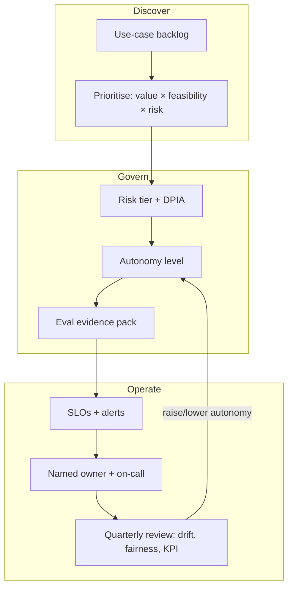

# 09 · Leading AI Initiatives: Discovery, Metrics, Governance, Responsible AI, Handover

> Status: DRAFT · Source: Week 3 Day 1, Day 5

## 1. Senior concept
- FDE through the lifecycle: **Discover** (use cases, KPIs) → **Design** (architecture, hosting, governance) → **Build** → **Evaluate** → **Operate & hand over** (adoption).
- Use-case prioritisation = **value × feasibility × risk** (data availability, decision reversibility, regulatory exposure).
- **Autonomy levels**: suggest → act with approval → act and notify → fully autonomous. Raise autonomy only with evidence.
- Responsible AI: fairness, transparency, privacy, accountability (named human owner), contestability.

## 2. Internals
- Discovery artefacts: process map, decision inventory, baseline metrics, data access list, stakeholder RACI.
- Three ways to host an agent: inside existing app (library), as a service (API/container), on a managed agent runtime (AgentCore, Vertex Agent Engine, Azure AI Foundry Agent Service).
- Governance: model/agent registry, risk tiering (EU AI Act categories), change control for prompts/models, eval evidence, incident process.
- Privacy with LLMs: data minimisation, PII redaction, zero-retention contracts, regional endpoints, DPIA.
- Handover: runbooks, SLOs, on-call owner, retraining/eval cadence, success criteria sign-off, kill switch.

## 3. Enterprise use case
UnderCover Head of Risk & Compliance role-play: demands explainability per decision, no auto-decline, audit for 7 years, EU data in EU. Outcome: autonomy = auto-approve ≤ $1k, all declines need human, reason + policy citation stored per decision.

## 4. Architecture


## 5. Code: decision record for auditability
```python
from datetime import datetime, timezone
from pydantic import BaseModel, Field

class DecisionRecord(BaseModel):
    claim_id: str
    decision: str                      # APPROVE | DECLINE | REFER
    payout: float
    policy_citations: list[str]        # e.g. ["4.2 Baggage delay"]
    reason: str
    model_id: str                      # provider/model@version
    prompt_version: str
    autonomy_level: str                # "auto" | "human-approved"
    approver: str | None = None
    trace_id: str
    created_at: datetime = Field(default_factory=lambda: datetime.now(timezone.utc))
```

## 6. Trade-offs
- Fast autonomy vs trust: start copilot, measure override rate, then automate slices.
- Central AI CoE vs federated teams: consistency vs speed; hybrid = central platform + guardrails, federated use cases.
- Explainability: LLM rationale is not causal explanation; pair with citations and deterministic rules.

## 7. Blind spots
- Measuring model accuracy but not adoption → shelfware.
- No contestability path for customers.
- Handover without budget for ongoing evals.
- Bias across segments (age, nationality) unmeasured.

## 8. Architect answer
"I run discovery to a ranked backlog with baselines, pick a reversible, data-ready decision, and agree autonomy with risk and compliance up front. Every decision is recorded with citations, model and prompt versions and the approver. Handover is complete only when an owner, SLOs, eval cadence and a kill switch exist and the client signs the success criteria."

## 9. Interview questions
- Senior: How do you prioritise use cases? · What's an autonomy level? · What's in a handover?
- Staff: Design AI governance for a bank. · Respond to a compliance veto. · Measure adoption.
- Architect: EU AI Act impact on a claims agent. · Operating model for an AI CoE. · Exit strategy from a vendor.

## 10. Pressure follow-ups
1. *CEO wants full automation in 3 months.* → Phased autonomy with gates tied to metrics.
2. *Compliance says LLMs can't explain.* → Citations + rules + record; humans on declines.
3. *Users override 40%.* → Investigate: wrong data, UX, or trust; fix before automating.
4. *Who owns the agent after you leave?* → Named product owner + on-call, in the contract.
5. *Bias found in one segment.* → Freeze autonomy for segment, root cause, re-eval, disclose.

---
### 🇮🇳 याद रखें
- Use case चुनो: value × feasibility × risk।
- Autonomy धीरे-धीरे बढ़ाओ: suggest → approval → notify → autonomous।
- हर फैसले का record: कारण, policy, model, approver।
- Handover = owner + SLO + eval cadence + kill switch।
