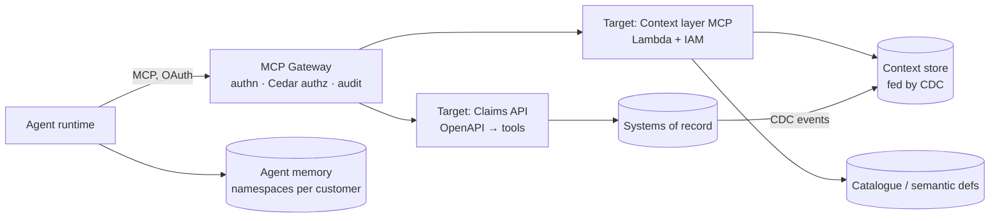

# 11 · Data & Integration Architecture: Enterprise Context Layer and MCP Gateway

> Status: DRAFT · Source: Week 3 Day 3

## 1. Senior concept
- **Enterprise context layer**: governed, semantically-described access to business data and knowledge for agents (definitions, lineage, ownership, policies) — the agent-era successor of the semantic layer/data catalogue (Atlan, Collibra, Unity Catalog, dbt semantic layer; Gartner frames it as context engineering at enterprise scale).
- **Systems of record** (policy admin, claims, CRM, payments) stay authoritative. Agents read through governed interfaces and write via APIs with business validation.
- **MCP gateway**: single front door that turns APIs/Lambdas into MCP tools, authenticates, authorises per tool (Cedar), logs, and rate-limits.
- Memory strategies (AgentCore Memory): **semantic** (facts), **summary** (session summaries), **user preference**, **episodic**; organised by **namespaces** (e.g., `/customers/{id}/claims`).

## 2. Internals
- Permissions: propagate end-user identity (OAuth on-behalf-of / token exchange) so the SoR enforces row-level access; avoid one god service account.
- Context layer API: `get_definition(term)`, `get_customer_context(id)`, `get_policy(product, version)` returning curated, minimal JSON with provenance.
- Gateway targets: OpenAPI spec → MCP tools; Lambda target; IAM or OAuth inbound auth; outbound credential provider per target.
- Freshness: CDC (Debezium/DMS) or event streams into context stores; TTL caches with invalidation.

## 3. Enterprise use case
Returning customer: gateway exposes two targets — **claims API** (Lambda, IAM auth) and **context layer** MCP server (customer tier, prior claims, policy definitions). AgentCore Memory namespace per customer recalls an earlier claim; Cedar forbids reading other customers' context.

## 4. Architecture


## 5. Code: context-layer MCP server with identity-scoped access
> ⚠️ Python `mcp` SDK 2.x renamed FastMCP → `from mcp.server.mcpserver import MCPServer` (verified with mcp 2.3.0). Snippet below is 1.x style: pin `mcp<2` or rename. Working 2.x code: `projects/secure-context-gateway`.
```python
from mcp.server.fastmcp import FastMCP, Context

mcp = FastMCP("context-layer")
DEFINITIONS = {"excess": "Amount the customer pays before cover applies."}

def caller_customer(ctx: Context) -> str:
    # Identity comes from the verified token the gateway forwards, never from tool args.
    claims = ctx.request_context.request.state.auth_claims   # set by auth middleware
    return claims["customer_id"]

@mcp.tool()
def get_definition(term: str) -> dict:
    """Business definition of a glossary term with its owner."""
    return {"term": term, "definition": DEFINITIONS.get(term.lower(), "unknown"), "owner": "claims-ops"}

@mcp.tool()
def get_my_claim_history(ctx: Context, limit: int = 5) -> list[dict]:
    """Prior claims for the authenticated customer only."""
    cid = caller_customer(ctx)
    return claims_repo.recent(customer_id=cid, limit=min(limit, 20))
```

## 6. Trade-offs
- Direct DB access vs context layer: speed now vs governance, semantics and reuse.
- One gateway vs per-team servers: central policy/audit vs bottleneck; federate ownership, centralise policy.
- Real-time API vs replicated context store: freshness vs SoR load and latency.
- Build vs buy context layer (Atlan/Collibra/Unity Catalog + MCP): fit vs time-to-value.

## 7. Blind spots
- Tool sprawl: 300 MCP tools degrades selection. Curate per agent; tool search.
- Semantic drift: "active customer" differs per system → definitions with owners.
- Write paths: agents bypassing SoR validation.
- Rate limits of legacy SoR; protect with bulkheads, caches.

## 8. Architect answer
"Agents get context through a governed layer, not raw databases. Systems of record stay authoritative; a context layer serves curated, defined, provenance-tagged data; and an MCP gateway is the single front door with identity propagation, per-tool Cedar policies and audit. Memory is namespaced per subject, so recall is scoped exactly like data access."

## 9. Interview questions
- Senior: What is a context layer? · Why identity propagation? · OpenAPI → MCP how?
- Staff: Integrate a mainframe SoR with agents. · Keep context fresh at scale. · Tool curation for many agents.
- Architect: Enterprise agent integration reference architecture. · Data mesh + context layer. · Governance of tool catalogue.

## 10. Pressure follow-ups
1. *Why not let the agent write SQL?* → Semantics, authz, injection, load; offer governed queries.
2. *Gateway is SPOF.* → Multi-AZ, regional, stateless, fail closed with cached policies.
3. *Agent needs data from 12 systems.* → Context layer aggregates; agent sees one tool.
4. *PII minimisation?* → Context layer returns only fields needed per tool; mask by default.
5. *Memory vs context layer?* → Memory = what the agent learned; context layer = what the business knows.

---
### 🇮🇳 याद रखें
- Context layer = agents के लिए governed, परिभाषित business data।
- System of record ही सच का स्रोत है।
- MCP gateway: एक दरवाज़ा, हर tool पर policy, audit।
- पहचान (identity) token से आती है, tool argument से नहीं।
