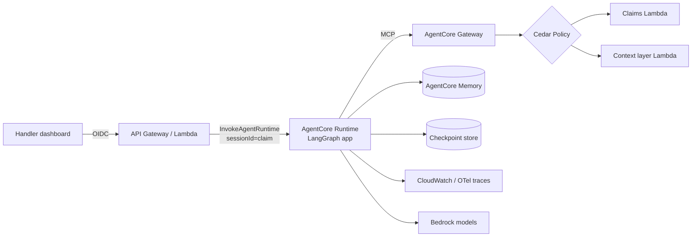

# 12 · Deploying LangGraph Agents with AWS Bedrock AgentCore (Runtime, Gateway, Policy, Memory)

> Status: DRAFT · Source: Week 3 Days 1–5. Verify CLI flags against current AgentCore docs before use.

## 1. Senior concept
- Production concerns: configuration, secrets, identity, scaling, session isolation, observability, cost, teardown.
- **AgentCore** components: **Runtime** (serverless, session-isolated microVMs, long-running sessions, any framework), **Gateway** (APIs/Lambdas → MCP tools), **Policy** (Cedar authz at gateway), **Memory** (short + long-term strategies), **Identity** (inbound/outbound auth), **Observability** (OTel → CloudWatch), plus Code Interpreter and Browser tools.
- Framework-agnostic: wrap a LangGraph app with `BedrockAgentCoreApp` and an `@app.entrypoint`.

## 2. Internals
- Runtime invocation carries a `runtimeSessionId`; same id → same session context; LangGraph checkpoint (e.g., Postgres or AgentCore Memory) enables resume across sessions.
- HITL on Runtime: graph interrupts → state persisted → handler signs off / sends back → new invocation with `Command(resume=...)`.
- Secrets: Secrets Manager / AgentCore Identity credential providers; never in images or env files in git.
- IaC: boto3 vs console vs Terraform vs CDK; prefer Terraform/CDK with remote state for anything kept.
- Cost hygiene: budgets + MFA + least-privilege IAM user/role; tear down gateways, runtimes, Lambdas, check Resource Explorer + Billing.

## 3. Enterprise use case
UnderCover agent on AgentCore Runtime; swarm of 25 claims; claims > $1k paused, signed off from dashboard (Lambda + Function URL + API key in pilot; Cognito/OIDC in prod). Capstone: **copilot agent** for handlers with per-handler memory, second agent on Runtime.

## 4. Architecture


## 5. Code
```python
# app.py
from bedrock_agentcore.runtime import BedrockAgentCoreApp
from langgraph.types import Command
from graph import build_graph            # your compiled LangGraph with a checkpointer

app = BedrockAgentCoreApp()
graph = build_graph()

@app.entrypoint
def invoke(payload: dict, context) -> dict:
    cfg = {"configurable": {"thread_id": payload["claim_id"]}}
    if "resume" in payload:                                  # handler sign-off / send back
        out = graph.invoke(Command(resume=payload["resume"]), cfg)
    else:
        out = graph.invoke({"claim_id": payload["claim_id"], "claimed": payload["claimed"], "audit": []}, cfg)
    pending = graph.get_state(cfg).interrupts
    return {"status": "PENDING_APPROVAL" if pending else "DONE", "audit": out.get("audit", [])}

if __name__ == "__main__":
    app.run()
```
```bash
# AgentCore CLI flow (names per course; check `agentcore --help`)
agentcore create          # scaffold
agentcore dev             # run locally
agentcore deploy          # build in the cloud (CodeBuild), push, create runtime
agentcore invoke '{"claim_id":"c-123","claimed":5000}'
agentcore invoke '{"claim_id":"c-123","resume":{"approved":true,"by":"h-7"}}'
```
Terraform guardrail for cost (any agent stack):
```hcl
resource "aws_budgets_budget" "agents" {
  name = "agent-pilot"; budget_type = "COST"; limit_amount = "50"; limit_unit = "USD"; time_unit = "MONTHLY"
  notification {
    comparison_operator = "GREATER_THAN"; threshold = 80; threshold_type = "PERCENTAGE"
    notification_type = "FORECASTED"; subscriber_email_addresses = [var.alert_email]
  }
}
```

## 6. Trade-offs
| Hosting | Pro | Con |
|---|---|---|
| AgentCore Runtime | Session isolation, long runs, managed MCP/policy/memory | AWS lock-in, newer service |
| Lambda | Cheap, simple | 15-min limit, cold starts, no session affinity |
| ECS/EKS | Full control, portable | Ops toil, you build isolation |
| LangGraph Platform | LangGraph-native durability/UI | Another vendor |
| Vertex Agent Engine / Azure AI Foundry Agent Service | Native to GCP/Azure | Equivalent lock-in elsewhere |

## 7. Blind spots
- Session id reuse across customers → data bleed. Derive from claim/customer, never user-supplied.
- Forgotten resources → surprise bills; tag everything, teardown scripts, budgets.
- Model access per region and quotas (TPM) block go-live; request early.
- Observability: correlate Runtime session ↔ LangGraph thread ↔ Langfuse trace ids.
- DR: Runtime is regional; plan multi-region invoke + replicated checkpoints/memory.

## 8. Architect answer
"I keep the agent framework-agnostic and wrap it for a managed runtime that gives per-session isolation and long-running execution. Tools go through a gateway with Cedar policy, memory is namespaced, secrets come from an identity/credential service, and everything emits OTel traces. IaC with budgets, tagging and teardown is part of the definition of done, and HITL resumes via the same thread id."

## 9. Interview questions
- Senior: Why microVM session isolation? · How does resume work on Runtime? · Lambda vs Runtime?
- Staff: Multi-region DR for agents. · Secrets and identity for tools. · Cost model for 1M invocations.
- Architect: AWS vs Azure vs GCP agent platforms. · Exit strategy from AgentCore. · Production readiness checklist.

## 10. Pressure follow-ups
1. *Runtime region down.* → Secondary region runtime, replicated state, DNS/client failover; RTO/RPO stated.
2. *Cost spike overnight.* → Budget alarm, per-session token caps, swarm concurrency limits, kill switch.
3. *Auditor asks who approved claim X.* → Decision record + trace + Cedar decision log.
4. *Move to Azure next year.* → Framework-neutral graph, MCP tools, OTel; only the wrapper changes.
5. *Cold start latency.* → Warm sessions, smaller images, async UX for long claims.

---
### 🇮🇳 याद रखें
- AgentCore: Runtime, Gateway, Policy, Memory, Identity, Observability।
- `BedrockAgentCoreApp` + `@app.entrypoint` से LangGraph agent deploy।
- Resume के लिए वही thread/session id।
- Budget, tags, teardown: production का हिस्सा हैं।
