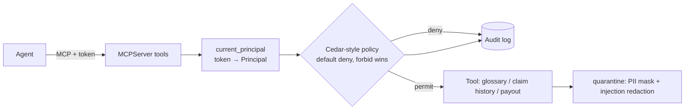

# Secure Context Gateway (MCP server + policy + guardrails)

Status: VALIDATED locally — 6 tests pass, ruff clean (mcp 2.3.0). Demo identity only; not deployed.



## Run
```bash
pip install -e ".[dev]"
pytest -q
GATEWAY_TOKEN=tok-agent python -m gateway.server     # stdio MCP server
```

## Policies (src/gateway/policy.py)
| Rule | Effect |
|---|---|
| glossary-public | anyone reads definitions |
| handler-reads-all / customer-reads-own | row-level by identity, not by argument |
| agent-small-payout | agent may approve ≤ $1,000 |
| handler-signed-off | handler approves with `human_approved=true` |
| hard-cap | forbid > $10,000 for everyone |
| suspended | forbid all |

## Production path
- Real Cedar (`cedarpy`) or AgentCore Policy / OPA; JWT validation (OIDC) on Streamable HTTP.
- Deploy behind AgentCore Gateway (Lambda target, IAM inbound) — guide 11/12.
- Ship audit log to CloudWatch/SIEM; add classifier-based injection check (guide 10).
