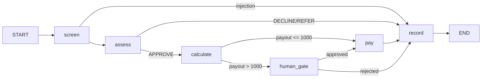

# UnderCover Claims Agent (LangGraph, durable, HITL)

Status: VALIDATED locally — 7 tests pass, ruff clean (Python 3.13, langgraph 1.2.24). Not deployed.



## Run
```bash
pip install -e ".[dev]"          # or: uv sync --extra dev
pytest -q                        # 7 tests: payout, injection, HITL, crash-resume, exactly-once pay, kappa
python -m undercover             # offline eval on data/claims.json (rule decider)
LLM_API_KEY=... python -m undercover --llm   # optional OpenRouter/OpenAI-compatible decider
```

## What it demonstrates (guide refs)
- Business logic in code: `core.calculate_payout`, thresholds (03)
- Fail-closed injection screen → REFER (10)
- `interrupt()` human gate > $1,000, resume with `Command(resume=...)` on a **new graph instance** sharing the checkpointer (07)
- Idempotent payment ledger keyed by `claim_id` (07)
- Cohen's κ + cost-weighted error (05)
- LLM decider treats claim text as data; errors fall back to REFER, never auto-approve (03, 10)

## Next steps (your assignment)
1. Swap `InMemorySaver` → `PostgresSaver` (`.[postgres]`, Supabase/RDS).
2. Add Langfuse tracing + `run_experiment` comparing rule vs LLM decider.
3. Fan-out swarm with `Send` + `max_concurrency` (guide 08).
4. Wrap with `BedrockAgentCoreApp` (guide 12) and call tools via `secure-context-gateway`.
